<picture>
  <source media="(prefers-color-scheme: dark)" srcset="assets/header-dark.svg">
  
</picture>

I'm a design verification engineer. By day I verify memory controller IP with SystemVerilog, UVM and
assertions. After hours I build the things I wish existed: a RISC-V core, Linux desktop tools and the
odd game.

## What I'm building

### rv32-core

A RISC-V CPU written from scratch in SystemVerilog, and my biggest project. It is a 5-stage pipeline
that implements RV32IM, and every phase has to pass four levels of verification before the next one
starts. The repository is private while the core grows towards caches, an MMU and out-of-order
execution.

| Check | Result |
| --- | --- |
| Official RISC-V tests, core against a reference model | 49 of 49 pass |
| Random programs, run in lock-step with the model | 2.4 million instructions, 0 mismatches |
| Formal proofs (riscv-formal) | 53 of 53 pass |
| Bugs injected on purpose | 18 of 18 caught |

### More projects

| | |
| --- | --- |
| **[claude-deck](https://github.com/borislisandro/claude-deck)** Rust | Runs many Claude Code sessions in one kitty window and puts a pixel critter per session on the KDE Plasma panel, so you can see which one is working, waiting or done. |
| **[JobScraper](https://github.com/borislisandro/JobScraper)** Tauri, React, Node | A desktop app that collects vacancies from 240 semiconductor career sites, filters them and tracks applications. Everything stays on your machine, and it never applies for you. |
| **gmk67-led-arcade** Python | Snake, Minesweeper and Lights Out played on the keycaps of an RGB keyboard, with a terminal simulator and an OpenRGB backend. Private for now. |
| **[spi-slave-ram-testbench](https://github.com/borislisandro/spi-slave-ram-testbench)** SystemVerilog | A class-based testbench for an SPI slave with a RAM, on the open-source flow: Verilator, GTKWave and Make. |

## Open source

**[LibrePods](https://github.com/librepods-org/librepods)** frees AirPods from Apple's ecosystem
(30k stars). I work on its Linux app, written in Rust.

- [Robust audio, hi-res mic and ear detection](https://github.com/librepods-org/librepods/pull/888)
  keeps sound and microphone working when buds go in and out, apps open and close the mic, PipeWire
  restarts or a phone takes the AirPods over. Open, 4,708 lines added.
- [Hi-res microphone follow-ups](https://github.com/LuanAdemi/librepods/pull/2) feed the branch that
  work builds on: tray handling and a single running instance. Open, 3,113 lines added.

I also co-develop a programming game in Godot with a friend. It is private, with 445 of my pull
requests merged so far.

## Earlier work

[PyOpenGL-raytracer](https://github.com/borislisandro/PyOpenGL-raytracer),
[AstroRun](https://github.com/borislisandro/AstroRun), a game in Processing,
[Museum-Heist](https://github.com/borislisandro/Museum-Heist), a distributed systems project in Java,
an [APB memory slave](https://github.com/borislisandro/AMBA_APB_mem_slave) and an
[ESP32 web server](https://github.com/borislisandro/ESP32-Web-Server-with-RCWL-9610-Sensor).
