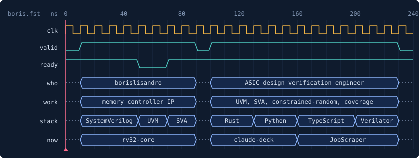
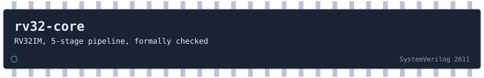
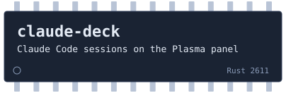
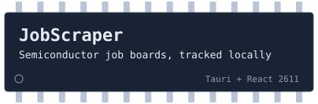
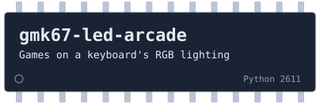
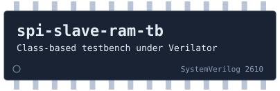

<a href="https://github.com/borislisandro?tab=repositories"></a>

I verify chips for a living: memory controller IP, with SystemVerilog, UVM and assertions. After hours I
build the things I wish existed, from a RISC-V core to Linux desktop tools, and I test them the way I
test silicon.

## On the bench

<a href="#on-the-bench"></a>

A RISC-V CPU written from scratch in SystemVerilog, and my biggest project. It is verified at four
levels, and every phase has to pass all of them before the next one starts. The repository is private
while the core grows towards caches, an MMU and out-of-order execution.

```text
riscv-tests, RTL against the reference model      49/49
constrained-random, lock-step against the model   2.4 M instructions, 0 mismatches
riscv-formal checks                               53/53
mutation campaign, injected RTL bugs caught       18/18
```

<table>
<tr>
<td width="50%" valign="top">
<a href="https://github.com/borislisandro/claude-deck"></a>
<br>
Runs many Claude Code sessions in one kitty window and puts a pixel critter per session on the KDE
Plasma panel, so you can see which one is working, waiting or done.
<a href="https://github.com/borislisandro/claude-deck">Open claude-deck</a>
</td>
<td width="50%" valign="top">
<a href="https://github.com/borislisandro/JobScraper"></a>
<br>
A desktop app that collects vacancies from 240 semiconductor career sites, filters them and tracks
applications. Everything stays on your machine, and it never applies for you.
<a href="https://github.com/borislisandro/JobScraper">Open JobScraper</a>
</td>
</tr>
<tr>
<td width="50%" valign="top">
<a href="#on-the-bench"></a>
<br>
Snake, Minesweeper and Lights Out played on the keycaps of an RGB keyboard, with a terminal simulator
and an OpenRGB backend. Private for now.
</td>
<td width="50%" valign="top">
<a href="https://github.com/borislisandro/spi-slave-ram-testbench"></a>
<br>
A class-based SystemVerilog testbench for an SPI slave with a RAM, running on the open-source flow:
Verilator, GTKWave and Make.
<a href="https://github.com/borislisandro/spi-slave-ram-testbench">Open spi-slave-ram-testbench</a>
</td>
</tr>
</table>

## Upstream

```text
UVM_INFO  librepods-org/librepods  #888  OPEN    robust audio, hi-res mic and ear detection on Linux   +4708 -519
UVM_INFO  LuanAdemi/librepods      #2    OPEN    hi-res mic follow-ups, tray and single instance       +3113 -566
UVM_INFO  private game, with a friend    MERGED  445 pull requests on a programming game in Godot

--- UVM Report Summary ---
UVM_INFO : 3   UVM_WARNING : 0   UVM_ERROR : 0   UVM_FATAL : 0
```

[LibrePods](https://github.com/librepods-org/librepods) frees AirPods from Apple's ecosystem. My work is
on the Linux app, written in Rust: [#888](https://github.com/librepods-org/librepods/pull/888) keeps the
audio and the microphone working when buds go in and out, apps open and close the mic, PipeWire
restarts or a phone takes the AirPods over.
[The follow-ups](https://github.com/LuanAdemi/librepods/pull/2) feed the hi-res microphone branch it
builds on.

## Earlier runs

[PyOpenGL-raytracer](https://github.com/borislisandro/PyOpenGL-raytracer),
[AstroRun](https://github.com/borislisandro/AstroRun), a game in Processing,
[Museum-Heist](https://github.com/borislisandro/Museum-Heist), a distributed systems project in Java,
an [APB memory slave](https://github.com/borislisandro/AMBA_APB_mem_slave) and an
[ESP32 web server](https://github.com/borislisandro/ESP32-Web-Server-with-RCWL-9610-Sensor).

```systemverilog
endclass : borislisandro
```
